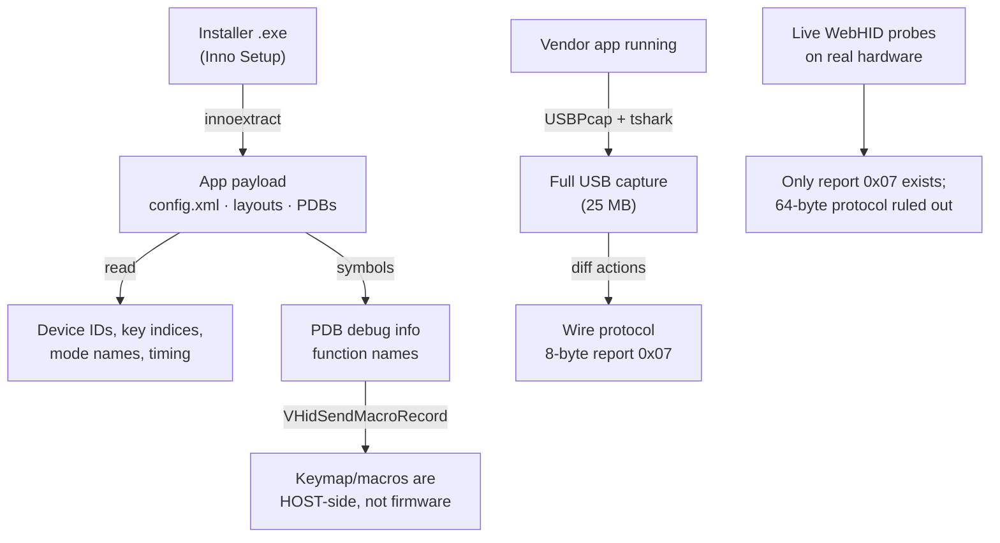
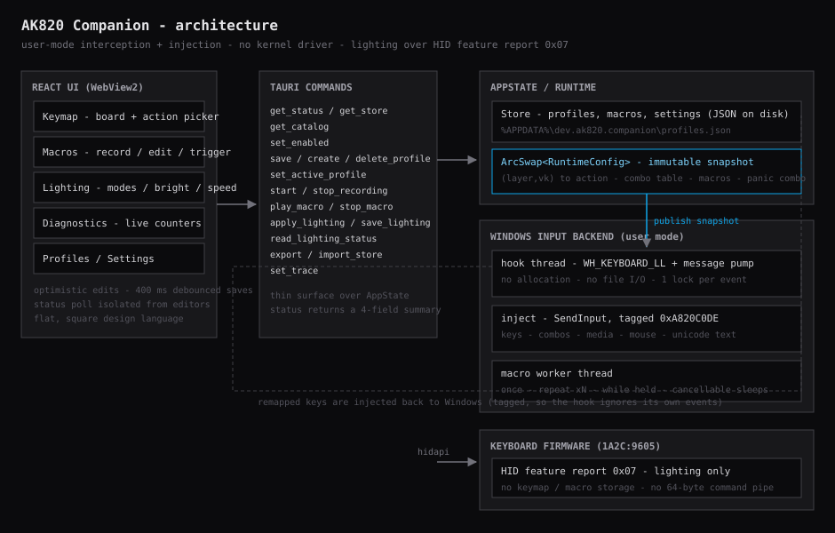
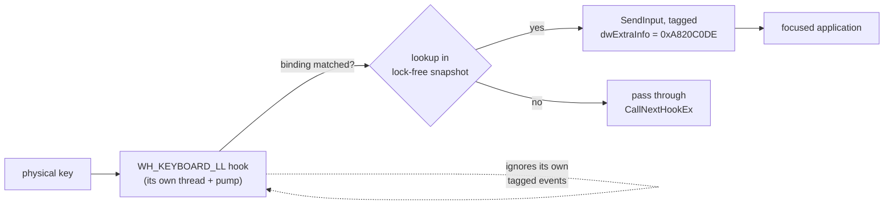

# AK820 Companion

> ### ⚠️ AI-GENERATED PROJECT — READ FIRST
> **This entire project was built with AI (an AI coding agent did the reverse
> engineering, the code, and this document, guided by a human).** Nothing here was
> hand-written from vendor sources. Treat it as an experiment and verify anything
> you rely on. See [Method](#3-method--how-this-was-reverse-engineered) for how the
> findings were obtained.

> ### Personal project
> Built for **my own use**, for one specific keyboard
> (AJAZZ AK820 wired single-light edition, `1A2C:9605`), on one Windows machine.
> No support, no warranty, no compatibility promises — but **if it is useful to you,
> you are very welcome to use it, read it, learn from it, or fork it.**

An open-source, user-mode **keymap / macro / lighting driver** for the AJAZZ AK820
that replaces the closed-source vendor application without installing a kernel driver.

---

## Abstract

The official AK820 driver is a closed-source Windows binary that installs a kernel
filter driver to remap keys. This project reverse-engineers what that software
actually does on the wire, documents it, and re-implements the useful parts as a
small open application built on documented Windows APIs: a low-level keyboard hook
(`WH_KEYBOARD_LL`) for interception, `SendInput` for injection, and HID feature
reports for lighting. Result: a ~3.3 MB executable that maps keys, runs macros,
manages profiles and controls the backlight, with no driver and no admin install.

## 1. Background

The AJAZZ AK820 wired single-light board ships with a vendor utility
(`AJAZZ_AK820_..._V1.0.exe`, Inno Setup, native MFC/Qt binary, `Beta 1.0.3.4`).
It is closed source, installs a kernel driver (`vhidflt.sys`), and gives no way to
script or audit what it sends to the keyboard.

Goal: find out **what the keyboard's firmware actually accepts**, then rebuild the
feature set on top of public APIs.

## 2. What the board is

| | |
|---|---|
| Device | AJAZZ AK820 wired single-light ("白光&冰蓝光") |
| USB IDs | `VID 1A2C` / `PID 9605` |
| Interfaces | `MI_00` standard keyboard · `MI_01` vendor collections |
| Command channel | one **8-byte HID feature report, report ID `0x07`** |
| Layout | `KB-K102`: 81 visible keys, 6×20 matrix, `Esc = index 0` |
| Lighting | 20 onboard modes + music (firmware-side) |

## 3. Method — how this was reverse-engineered

No vendor source, no leaked code: only shipped artefacts and observation.



| Step | Tool | Yield |
|---|---|---|
| Unpack installer | `innoextract` | `config.xml`, `layouts/KB-K102.xml`, language files, DX `.pdb` symbols |
| Read symbols | string scan of `DeviceDriver.pdb` | `VHidSendMacroRecord`, `m_bVHidDevice`, `HidD_SetFeature` |
| Capture traffic | USBPcap + Wireshark/`tshark` | every byte the vendor app sent, per action |
| Probe the device | WebHID in Chrome | which reports/commands the firmware accepts |
| Confirm behaviour | the keyboard itself | LEDs, remaps, macros |

## 4. Findings

**4.1 The wire protocol is tiny.** The app only ever sent one kind of packet —
a HID `SET_REPORT` (feature, report ID `0x07`, 8 bytes) to `MI_01`:

```
07 FF FF <mode-1> <brightness-1> <speed-1> 00 00     set lighting state
07 F0 AA 00 00 00 00 00                              commit (save) on exit
```

Fire-and-forget: the vendor app never reads the device back (15 writes in the
capture, zero `GET_REPORT`).

**4.2 Mode numbers are 0-indexed modes.** `Steady` (UI mode 1) → `0x00`,
`Breathing` (mode 3) → `0x02`, i.e. wire byte = mode − 1. Brightness and speed
are likewise 0-indexed (`5` in the UI → `0x04`).

**4.3 Keymap and macros are NOT in the firmware.** Performing a remap and a macro
recording in the vendor UI produced **zero** USB writes. The shipped PDB explains
why: the app watches key passes and injects replacements through a **virtual HID
keyboard driver** (`vhidflt.sys`, KMDF VHF) — the same architecture as AutoHotkey,
but with a signed driver.

**4.4 There is no hidden bigger protocol.** The board exposes exactly one usable
pipe. Live probes: report ID `0` → *"Failed to write the feature report"*; output
reports → rejected. So the AK820-Pro-style 64-byte `04 xx` command family
(`04 18` session open, 576-byte key tables, …) **cannot be delivered to this
firmware**. Firmware-side keymaps are impossible on this model.

**4.5 A bonus:** report `0x07` is *readable* (`01 16 00 …`), something the vendor
app never uses. Layout not yet decoded.

Full byte-level detail: [`docs/PROTOCOL.md`](docs/PROTOCOL.md).

## 5. Implementation — how it works

Since the vendor solution is "intercept on the host, inject on the host", this
project does the same with public APIs and **no driver**.





* **Interception** — `SetWindowsHookExW(WH_KEYBOARD_LL)` on a dedicated thread with
  a message pump. The callback is allocation-free and does no file I/O.
* **Loop prevention** — every injected event carries a magic `dwExtraInfo`; the hook
  returns immediately for its own input, so remaps cannot feed back.
* **Bindings** — `layer + virtual-key` → action, compiled into an
  immutable snapshot swapped atomically (`ArcSwap`); the callback never locks to
  decide.
* **Layers** — a layer key (CapsLock / Right Alt / Scroll Lock) is swallowed and
  shifts the active layer while held; per-key momentary layers are supported too.
* **Combos** — exact modifier matching: `J`, `Ctrl+J` and `Ctrl+Shift+J` are three
  different bindings.
* **Macros** — recorded as `key down / key up / delay / mouse` events, played by a
  cancellable worker thread (`once`, `repeat ×N`, `while held`), with interruptible
  sleeps so stopping is instant.
* **Lighting** — the reverse-engineered `0x07` report via `hidapi`, live-applied and
  separately committable (`0xF0 0xAA`).
* **Safety** — a panic combo (`Ctrl+Alt+Esc`) disables remapping instantly, a tray
  toggle does the same, and disabling releases every key still held (no stuck keys).
* **Observability** — the hook exposes counters (events / remapped / panics) to the
  UI, and writes a log file; per-remap logging is opt-in so typing stays fast.

## 6. Verification

* **19 Rust unit tests** covering profile persistence, binding resolution
  (layers, combo exactness, disabled entries) and the macro engine.
* **Hardware-verified** against the physical keyboard: lighting modes/brightness/
  speed apply over HID; the hook installs and remaps; panic fires.
* **Wire truth** — every protocol claim traces back to the capture or a live probe;
  where something is inferred rather than observed, the docs say so.

## 7. Repository map

```
ak820-companion/
├── src/                       React UI (flat, square)
│   ├── data/layout.ts         keyboard geometry (generated from the vendor layout)
│   ├── data/hidToVk.ts        HID usage → Windows virtual-key
│   ├── state/app.tsx          split contexts, optimistic edits, debounced saves
│   ├── components/            KeyboardSvg · ActionPicker · UI kit
│   └── views/                 Keymap · Macros · Lighting · Diagnostics · Profiles · Settings
├── src-tauri/src/
│   ├── platform/windows/      hook.rs · inject.rs · macros.rs · vk.rs
│   ├── profile.rs             data model + JSON persistence (+ tests)
│   ├── state.rs               lock-free runtime snapshot (+ tests)
│   ├── lighting.rs            HID feature-report transport
│   ├── commands.rs            Tauri command surface
│   └── logging.rs             file logger
├── docs/ARCHITECTURE.md       design + performance notes
└── docs/figures/              diagrams
```

## 8. Usage

```bash
bun install

# development: starts the Vite dev server (5174) and the app against it
bun tauri dev

# standalone app + installers (UI embedded, no dev server needed)
bun tauri build        # -> src-tauri/target/release/bundle/{msi,nsis}
bun run app            # exe only, no installers (faster)
cargo test             # from src-tauri/
```

> **Two gotchas that cost me an evening:**
> 1. **Never build with plain `cargo build --release`.** Outside the Tauri CLI the
>    build keeps the `dev` cfg, so the binary looks for `http://localhost:5174`
>    instead of embedding the UI — you get a "localhost refused to connect" window.
>    Always use `bun tauri build` / `bun run app`.
> 2. **The app is single-instance.** Close any running copy before `bun tauri dev`,
>    otherwise the newly started app exits immediately (and the dev server goes with
>    it, reporting exit code 255).

Requires Windows 10/11, Rust (MSVC), bun, WebView2. Then: **Keymap** → click a key →
choose an action → flip **Remap ON** in the header. Macros bind their own trigger key.
Lighting has its own tab. See [Known limits](#9-known-limits).

## 9. Known limits

* **Elevated windows.** Windows UIPI blocks a standard-user process from injecting
  into administrator windows — run as administrator for full coverage.
* **Games / anti-cheat** may ignore `SendInput`. Avoiding a kernel driver is the
  deliberate trade-off.
* **Fn** is handled by the keyboard firmware and never reaches Windows.
* **Non-RGB board:** this is the single-light model; per-key colour is not available.

## 10. Related

* A separate browser (WebHID) lighting controller for the same board lives outside
  this repository, and shares the protocol write-up in [`docs/PROTOCOL.md`](docs/PROTOCOL.md).
* Architecture of the official app, as observed: host-side hooking + a signed
  virtual-HID driver (`vhidflt.sys`) shipped inside its installer.

## Licence & intent

Personal project, provided **as-is, with no warranty**. Use it at your own risk on
your own hardware. Others are welcome to use and study it; attribution is
appreciated. No vendor code, binaries, or artwork are included — the keyboard
drawing is generated from key geometry, and every protocol finding is documented
from observation.
